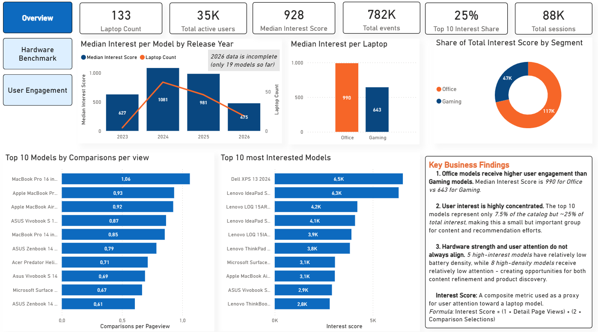
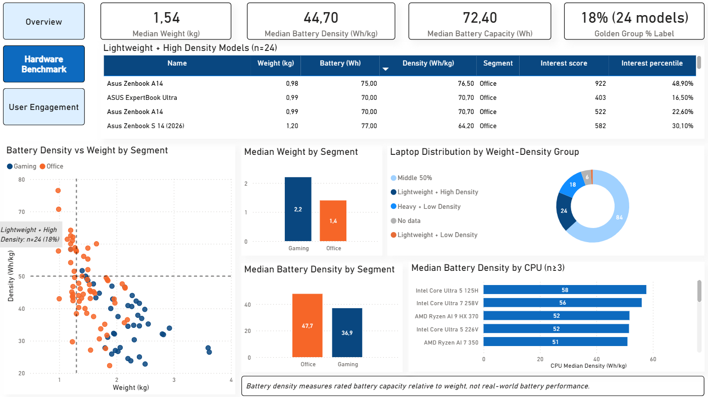
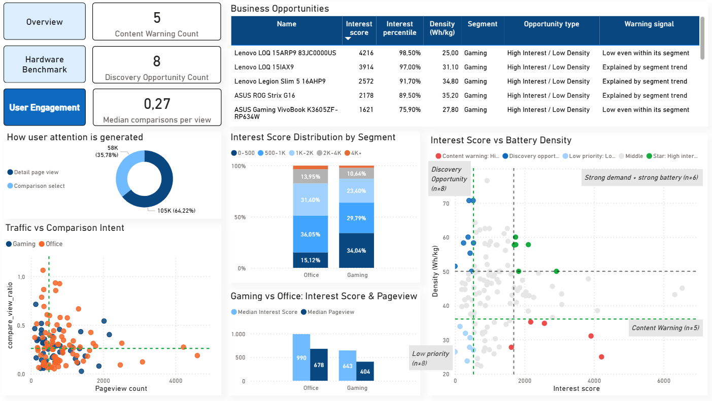
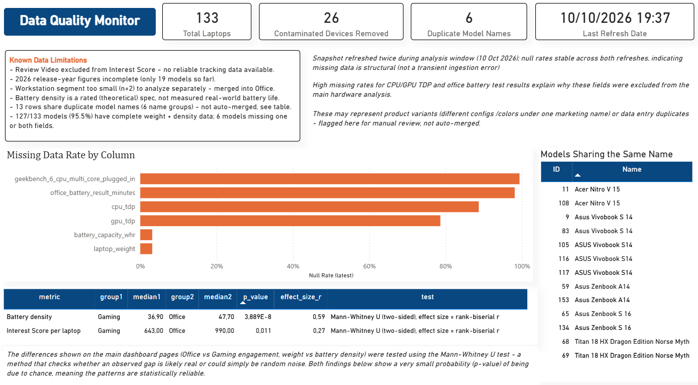

# LapLap Tech Analytics

Dự án cá nhân phân tích bộ dữ liệu thực hành của website laptop Laplap Tech: hành vi người dùng
(clickstream) và thông số kỹ thuật laptop. Mục tiêu là hiểu người dùng đang chú ý đến những sản phẩm
nào, và những sản phẩm đó có đặc tính phần cứng ra sao.

**Công cụ:** SQL (ClickHouse), Python (pandas, scipy, matplotlib, seaborn), Jupyter, Power BI.

## Problem

Bài toán được đặt ra theo **kịch bản giả định** (không phải yêu cầu của một khách hàng thật):
một website laptop cần trả lời 3 câu hỏi kinh doanh chính (chi tiết: `docs/project_notes.md`, mục 1.1):
- **Sản phẩm/UX:** người dùng quan tâm chỉ số nào nhất, tính năng nào thu hút nhất?
- **Nội dung/Review:** mẫu laptop/CPU/GPU nào đang hot, nhược điểm nào đáng chú ý?
- **Kinh doanh/Affiliate:** trade-off nào người dùng chấp nhận, mẫu nào nên đẩy mạnh?

## Data

- **Nguồn:** Bộ dữ liệu thực hành do Xóm Data chia sẻ công khai trên Facebook
  (https://www.facebook.com/share/p/19kXDBNJdV/).
  Đây là phân tích cá nhân, không liên kết với Xóm Data hay Laplap Tech; dữ liệu không được phân phối
  lại trong repo này.
- **Bảng chính:** `user_event_tracking` (clickstream, ~259K pageview events), `laptop_model`
  (thông số kỹ thuật, 159 dòng gốc), `laptop_benchmark_result`, `brand`/`cpu_model`/`gpu_model`
  (dimension đã chuẩn hóa).
- **Quy mô sau làm sạch:** 133/159 laptop (đã loại 26 thiết bị không phải laptop và chuẩn hóa
  đơn vị trọng lượng - chi tiết `src/cleaning.py`).
- **Giới hạn dữ liệu quan trọng:** `laptop_benchmark_result` rất thưa - chỉ 1/133 laptop sạch
  có dữ liệu benchmark (Geekbench và thời lượng pin tự đo).
  Điều này buộc pivot 2 hypothesis (H1→H1', Golden Ratio/H9 đổi sang dùng `battery_density`
  thay vì đo hiệu năng pin thực tế) — xem đầy đủ lý do trong `docs/project_notes.md`.
- **Snapshot dữ liệu:** 2026-10-10 (nguồn là dữ liệu sống; mọi số liệu trong repo dùng snapshot này).

## Methodology

Pipeline: `sql/exploration.sql` (profiling + validation) → `src/cleaning.py` (làm sạch, phát
hiện contamination) → `notebooks/01-04` (EDA + kiểm định thống kê) → `notebooks/05` (chuẩn bị dữ liệu Dashboard).

- Toàn bộ giả định, quyết định pivot, và log điều tra chi tiết: `docs/project_notes.md`.
- Kiểm định dùng Mann-Whitney (dữ liệu lệch phân phối) kèm effect size (rank-biserial r), không
  chỉ p-value đơn lẻ.
- `interest_score'` (chỉ số mức độ quan tâm) được xây dựng qua điều tra thực nghiệm nhiều bước
  (không đoán tên event), containment validation đạt 78.3% khi đối chiếu với bảng QA độc lập.
  Interest Score = 1 × Detail Page Views + 2 × Comparison Selects.
  Review Video bị loại khỏi công thức vì không có dữ liệu tracking tương ứng
  (xem `docs/project_notes.md`, mục "Chuẩn hóa metric cho Dashboard").

## Key Findings

1. **Ultrabook mỏng nhẹ chiếm ưu thế mật độ pin; gaming là ngoại lệ hiếm** — 24 laptop đạt
   "Golden Ratio" (nhẹ nhất + mật độ pin cao nhất), effect size lớn (r=0.586, p≈4×10⁻⁸).
2. **Người dùng thực ra quan tâm laptop văn phòng NHIỀU HƠN gaming** — ngược với giả thuyết
   ban đầu (p=0.011, r=0.27), đã kiểm tra loại trừ biến nhiễu năm ra mắt.
3. **2 model gaming "hot nhưng mật độ pin kém bất thường"** — Lenovo LOQ 15ARP9, ASUS
   VivoBook K3605ZF-RP634W — outlier thật ngay cả trong nội bộ phân khúc gaming.

Chi tiết đầy đủ kèm biểu đồ: `reports/insight_summary.md`.

## Business Recommendation

| Insight | Đề xuất | Đội ngũ |
|---|---|---|
| Golden Ratio ultrabook | Bộ lọc "Mật độ pin cao" trên app; content "Top ultrabook pin khỏe" | Sản phẩm, Nội dung |
| Văn phòng > Gaming interest | Rà lại tỷ trọng hiển thị gaming vs văn phòng | Product/UX, Affiliate |
| 2 model hot nhưng pin kém | Content dạng cảnh báo/review sâu cho 2 model cụ thể | Nội dung, Affiliate |

## Impact (ước tính, có giả định)

Các ước tính dưới đây là **minh họa cách tư duy định lượng**, không phải số đo thực tế
(dataset không có dữ liệu doanh thu/CTR thật). Công thức và giả định chi tiết: xem từng
insight trong `reports/insight_summary.md`.

## Dashboard

Power BI (`reports/laplaptech_dashboard.pbix`), 3 trang chính kể một câu chuyện:
người dùng chú ý gì → sản phẩm ra sao → chỗ nào hai thứ lệch nhau.

### 1. Overview — Người dùng đang chú ý điều gì?

- Laptop văn phòng có Interest Score trung vị cao hơn Gaming (990 so với 643).
- 10 model đầu chiếm ~25% tổng Interest dù chỉ là 7.5% danh mục.

### 2. Hardware Benchmark — Đánh đổi nào định nghĩa laptop hấp dẫn?

- Office nhẹ hơn (1.4 so với 2.2 kg) và có mật độ pin cao hơn (47.7 so với 36.9 Wh/kg).
- 24 model (18%) thuộc nhóm "nhẹ + mật độ pin cao".

### 3. User Engagement — Sự chú ý lệch khỏi đặc tính sản phẩm ở đâu?

- 5 model được quan tâm nhiều nhưng mật độ pin thấp; 8 model mật độ pin cao nhưng ít được chú ý.
- Interest Score gồm 64% từ lượt xem chi tiết và 36% từ lượt chọn so sánh.

### Phụ lục: Data Quality Monitor (trang ẩn)


Trang dành cho người cần chi tiết kỹ thuật: tỷ lệ thiếu dữ liệu theo cột, số thiết bị bị loại,
các tên model trùng, và kết quả kiểm định thống kê (p-value, effect size).

**Ghi chú thiết kế:** Dashboard được thiết kế dạng kể chuyện cố định (không dùng slicer) cho người xem
không chuyên kỹ thuật. Các đường ngưỡng trên scatter được nhập tay từ `dashboard_thresholds.csv`.

## Repo Structure

```text
LAPLAPTECH/
├── README.md
├── requirements.txt
├── run_all.py                  # chạy tuần tự notebook 01→05
├── .env.example                # mẫu biến kết nối ClickHouse (không chứa mật khẩu)
├── sql/                        # exploration.sql (profiling+validation), metrics.sql (interest_score, CPU ratio)
├── src/                        # db.py (kết nối+cache+note), cleaning.py, metrics.py (thống kê), viz.py (biểu đồ)
├── notebooks/                  # 01 cleaning/profiling, 02–04 EDA theo 3 trục, 05 dashboard data prep
├── docs/                       # assumption_log.md, project_notes.md (nhật ký theo giai đoạn), erd.md
├── reports/                    # insight_summary.md, figures/, dashboard/ (ảnh chụp), laplaptech_dashboard.pbix
└── data/                       # raw/ (cache truy vấn), processed/ (CSV đầu ra) — không commit, xem .gitignore
```

## Time-box

| Giai đoạn | Nội dung | Thời gian thực tế |
|---|---|---|
| 0 | Chuẩn bị kỹ thuật, ERD | 3 ngày |
| 1 | Bối cảnh kinh doanh, hypotheses | 2 ngày |
| 2 | Làm sạch dữ liệu, Data Quality Audit | 3 ngày |
| 3 | EDA, kiểm định thống kê | 2 ngày |
| 4 | Đúc kết insight & đề xuất | 1 ngày |
| 5 | Dashboard | 3 ngày |
| 6 | Documentation & Deliverable | 1 ngày |
| **Tổng** | | 15 ngày |

## Reproducibility

1. **Yêu cầu:** Python 3.12. Cài thư viện: `pip install -r requirements.txt`
   (khuyến nghị dùng môi trường ảo: `python -m venv .venv`, rồi kích hoạt trước khi cài).
2. **Truy cập dữ liệu:** dữ liệu không được phân phối lại trong repo này. Thông tin kết nối ClickHouse
   (chỉ-đọc) lấy từ bài đăng gốc của Xóm Data (link ở mục Data). Chép `.env.example` thành `.env`
   và điền 5 biến `CH_HOST`, `CH_PORT`, `CH_USERNAME`, `CH_PASSWORD`, `CH_DATABASE`.
   Không commit file `.env`.
3. **Chạy pipeline:** `python run_all.py` (chạy tuần tự notebook 01→05; bản đã chạy được lưu trong
   `reports/executed_notebooks/`). Chạy một phần: `python run_all.py 02 04`.
4. **Cache:** kết quả truy vấn được lưu trong `data/raw/`; các lần chạy sau dùng lại cache thay vì
   truy vấn lại server. Muốn lấy dữ liệu mới, xóa file cache tương ứng.
5. **Power BI:** mở `reports/laplaptech_dashboard.pbix` bằng Power BI Desktop, đổi nguồn dữ liệu trỏ
   về thư mục `data/processed/` (Transform data → Data source settings → Change Source). Locale khi
   import là English (US).

Pipeline từ ClickHouse đến các file CSV được code hóa; phần dựng Power BI là thao tác thủ công,
và các đường ngưỡng trên scatter được nhập tay từ `dashboard_thresholds.csv`. Giả định và quyết
định pivot được ghi lại trong `docs/project_notes.md` và `docs/assumption_log.md`.

## Limitations

- **Bộ lọc thiết bị:** thiết bị không phải laptop được loại bằng từ khóa trong tên và ngưỡng trọng
  lượng (26/159 dòng). Có thể loại nhầm hoặc sót khi dữ liệu thay đổi.
- **Benchmark rất thưa:** chỉ 1/133 laptop sạch có dữ liệu benchmark, nên không kiểm định được các
  giả thuyết gốc dựa trên Geekbench pin/cắm sạc (H1) và thời lượng pin tự đo (H8).
- **TDP thiếu nhiều:** khoảng 88% (CPU) và 74% (GPU) laptop sạch không có TDP, nên không dùng trong
  phân tích chính.
- **Mật độ pin là chỉ số danh định:** tính từ dung lượng pin và trọng lượng theo thông số (Wh/kg),
  không phải thời lượng pin thực tế.
- **Interest Score chỉ là proxy:** dựa trên lượt xem chi tiết và lượt chọn so sánh; không gồm review
  video và không phản ánh doanh thu. Các kết quả mang tính tương quan, chưa phải nhân quả.
- **Mẫu nhỏ:** nhóm Workstation chỉ có 2 model (gộp vào Office); năm 2026 mới có 19 model; nhóm
  Gaming có 47 model.
- **Tên model trùng:** 13 dòng (6 nhóm tên) chưa được gộp, chỉ đánh dấu để rà soát.
- **Snapshot:** nguồn là dữ liệu sống; mọi số liệu trong repo cố định tại snapshot 2026-10-10.
- **Dashboard:** một số chú thích trên biểu đồ (số lượng nhóm) và các đường ngưỡng được nhập tay,
  sẽ không tự cập nhật khi dữ liệu thay đổi.