# ERD - laplaptech database

```mermaid
erDiagram
    brand {
        Nullable_Int64 changed_by_fk
        Nullable_DateTime64_3 changed_on
        Nullable_Int64 created_by_fk
        Nullable_DateTime64_3 created_on
        Nullable_DateTime64_3 elton_created_at
        Nullable_Int64 id
        Nullable_Bool is_chip_brand
        Nullable_String name
    }

    cpu_model {
        Nullable_Int64 brand_id
        Nullable_Int64 changed_by_fk
        Nullable_DateTime64_3 changed_on
        Nullable_Int64 created_by_fk
        Nullable_DateTime64_3 created_on
        Nullable_DateTime64_3 elton_created_at
        Nullable_Int64 id
        Nullable_Bool is_active
        Nullable_String name
    }

    gpu_model {
        Nullable_Int64 brand_id
        Nullable_Int64 changed_by_fk
        Nullable_DateTime64_3 changed_on
        Nullable_Int64 created_by_fk
        Nullable_DateTime64_3 created_on
        Nullable_DateTime64_3 elton_created_at
        Nullable_Int64 id
        Nullable_Bool is_active
        Nullable_String name
    }

    int_comparison_chart_device {
        Nullable_String brand_name
        Nullable_Int64 event_id
        Nullable_Int64 event_local_ts
        Nullable_Int64 laptop_model_id
        Nullable_String laptop_model_name
        Nullable_String session_id
        Nullable_String sort_by
        Nullable_String sort_direction
        Nullable_String user_psuedo_id
    }

    int_dim_laptop {
        Nullable_String brand_name
        Nullable_String cpu_name
        Nullable_Float64 gaming_battery_result_minutes
        Nullable_Float64 geekbench_6_compute_gpu_plugged_in
        Nullable_Float64 geekbench_6_cpu_multi_core_plugged_in
        Nullable_String gpu_name
        Nullable_Bool is_active
        Nullable_Bool is_gaming_laptop
        Nullable_Bool is_mobile_device
        Nullable_Bool is_workstation
        Nullable_Int64 l_laptop_model_id
        Nullable_String laptop_model_name
        Nullable_Float64 laptop_weight
        Nullable_Float64 office_battery_result_minutes
        Nullable_Float64 screen_size
        Nullable_Int64 year_introduce
    }

    int_events_enriched {
        Nullable_String app_version
        Nullable_String brand_name
        Nullable_String cpu_name
        Nullable_Int64 event_local_ts
        Nullable_String event_name
        Nullable_Int64 event_server_ts
        Nullable_UInt8 funnel_step
        Nullable_String gpu_name
        Nullable_Int64 id
        Nullable_Int64 l_laptop_model_id
        Nullable_String laptop_model_name
        Nullable_String page_name
        Nullable_Int64 page_number
        Nullable_String page_url
        Nullable_String referrer
        Nullable_Int64 resolved_laptop_model_id
        Nullable_String search_keyword
        Nullable_String session_id
        Nullable_Int64 user_id
        Nullable_String user_psuedo_id
    }

    laptop_benchmark_result {
        Nullable_Int64 changed_by_fk
        Nullable_DateTime64_3 changed_on
        Nullable_Int64 created_by_fk
        Nullable_DateTime64_3 created_on
        Nullable_DateTime64_3 elton_created_at
        Nullable_Float64 foldable_opening_battery_result_minutes
        Nullable_Float64 gaming_battery_result_minutes
        Nullable_Float64 geekbench_6_compute_gpu_battery
        Nullable_Float64 geekbench_6_compute_gpu_plugged_in
        Nullable_Float64 geekbench_6_cpu_multi_core_battery
        Nullable_Float64 geekbench_6_cpu_multi_core_plugged_in
        Nullable_Float64 geekbench_6_cpu_single_core_battery
        Nullable_Float64 geekbench_6_cpu_single_core_plugged_in
        Nullable_Float64 geekbench_7_compute_gpu_battery
        Nullable_Float64 geekbench_7_compute_gpu_plugged_in
        Nullable_Float64 geekbench_7_cpu_multi_core_battery
        Nullable_Float64 geekbench_7_cpu_multi_core_plugged_in
        Nullable_Float64 geekbench_7_cpu_single_core_battery
        Nullable_Float64 geekbench_7_cpu_single_core_plugged_in
        Nullable_Int64 id
        Nullable_Bool is_active
        Nullable_Int64 laptop_model_id
        Nullable_String note
        Nullable_Float64 office_battery_result_minutes
        Nullable_String review_video_url
    }

    laptop_catalog {
        Nullable_String brand
        Nullable_String cpu
        Nullable_String gpu
        Nullable_String name
    }

    laptop_model {
        Nullable_Float64 battery_capacity_whr
        Nullable_Int64 brand_id
        Nullable_String brand_model_codename
        Nullable_Int64 changed_by_fk
        Nullable_DateTime64_3 changed_on
        Nullable_Float64 charger_weight
        Nullable_Int64 cpu_model_id
        Nullable_String cpu_note
        Nullable_String cpu_tdp
        Nullable_Int64 created_by_fk
        Nullable_DateTime64_3 created_on
        Nullable_DateTime64_3 elton_created_at
        Nullable_Int64 gpu_model_id
        Nullable_String gpu_note
        Nullable_String gpu_tdp
        Nullable_Int64 id
        Nullable_Bool is_active
        Nullable_Bool is_gaming_laptop
        Nullable_Bool is_mobile_device
        Nullable_Bool is_visible
        Nullable_Bool is_workstation
        Nullable_Float64 laptop_weight
        Nullable_String name
        Nullable_Float64 screen_dimension_height
        Nullable_Float64 screen_dimension_width
        Nullable_Float64 screen_ppi
        Nullable_Float64 screen_size
        Nullable_String thumbnail_image_url
        Nullable_Int64 year_introduce
    }

    stg_brand {
        Nullable_Int64 brand_id
        Nullable_String brand_name
        Nullable_Bool is_chip_brand
    }

    stg_cpu_model {
        Nullable_Int64 brand_id
        Nullable_Int64 cpu_model_id
        Nullable_String cpu_name
        Nullable_Bool is_active
    }

    stg_gpu_model {
        Nullable_Int64 brand_id
        Nullable_Int64 gpu_model_id
        Nullable_String gpu_name
        Nullable_Bool is_active
    }

    stg_laptop_benchmark_result {
        Nullable_Float64 foldable_opening_battery_result_minutes
        Nullable_Float64 gaming_battery_result_minutes
        Nullable_Float64 geekbench_6_compute_gpu_battery
        Nullable_Float64 geekbench_6_compute_gpu_plugged_in
        Nullable_Float64 geekbench_6_cpu_multi_core_battery
        Nullable_Float64 geekbench_6_cpu_multi_core_plugged_in
        Nullable_Float64 geekbench_6_cpu_single_core_battery
        Nullable_Float64 geekbench_6_cpu_single_core_plugged_in
        Nullable_Bool is_active
        Nullable_Int64 laptop_benchmark_result_id
        Nullable_Int64 laptop_model_id
        Nullable_Float64 office_battery_result_minutes
    }

    stg_laptop_model {
        Nullable_Float64 battery_capacity_whr
        Nullable_Int64 brand_id
        Nullable_String brand_model_codename
        Nullable_Float64 charger_weight
        Nullable_Int64 cpu_model_id
        Nullable_String cpu_tdp
        Nullable_Int64 gpu_model_id
        Nullable_String gpu_tdp
        Nullable_Bool is_active
        Nullable_Bool is_gaming_laptop
        Nullable_Bool is_mobile_device
        Nullable_Bool is_visible
        Nullable_Bool is_workstation
        Nullable_Int64 laptop_model_id
        Nullable_String laptop_model_name
        Nullable_Float64 laptop_weight
        Nullable_Float64 screen_size
        Nullable_Int64 year_introduce
    }

    stg_user_event_tracking {
        Nullable_String app_version
        Nullable_String device
        Nullable_String event_data_raw
        Nullable_Int64 event_local_ts
        Nullable_String event_name
        Nullable_Int64 event_server_ts
        Nullable_Int64 id
        Nullable_String page_name
        Nullable_String page_url
        Nullable_String referrer
        Nullable_String session_id
        Nullable_Int64 user_id
        Nullable_String user_psuedo_id
    }

    user_event_tracking {
        Nullable_String app_version
        Nullable_String device
        Nullable_DateTime64_3 elton_created_at
        Nullable_String event_data
        Nullable_Int64 event_local_timestamp
        Nullable_String event_name
        Nullable_Int64 event_received_on_server_timestamp
        Nullable_Int64 id
        Nullable_String session_id
        Nullable_Int64 user_id
        Nullable_String user_psuedo_id
    }


    %% ===== Quan hệ chính dùng để JOIN khi phân tích (ClickHouse không có FK) =====
    laptop_model }|--|| brand : "thuoc ve"
    laptop_model }|--|| cpu_model : "su dung"
    laptop_model }|--|| gpu_model : "su dung"
    laptop_benchmark_result }|--|| laptop_model : "ket qua test cua"
    user_event_tracking }o--|| laptop_model : "hanh vi (qua JSON_EXTRACT device_id)"

    %% ===== Bang denormalized dung de QA/doi chieu, KHONG thay the viec tu JOIN =====
    int_dim_laptop ||--|| laptop_model : "QA - flat table doi chieu ket qua tu JOIN 5 bang"
    int_events_enriched }o--|| laptop_model : "QA - resolved_laptop_model_id vs toInt64(device_id)"
    int_comparison_chart_device }o--|| laptop_model : "QA - component click So sanh trong interest_score"

```

## Ghi chú phân loại bảng

**Bảng chính dùng để JOIN khi phân tích (Bước 1 - sql/extraction.sql):**
`laptop_model`, `brand`, `cpu_model`, `gpu_model`, `laptop_benchmark_result`, `user_event_tracking`

**Bảng denormalized — dùng để QA/đối chiếu, KHÔNG thay thế việc tự viết JOIN:**
- `int_dim_laptop`: flat table có sẵn brand/cpu/gpu/benchmark theo từng laptop.
- `int_events_enriched`: có cả `laptop_model_id` (thô) và `resolved_laptop_model_id` (đã xử lý).
- `int_comparison_chart_device`: nguồn đối chiếu cho thành phần "click So sánh" trong `interest_score`.

**Bảng không có khóa liên kết — chỉ tham khảo, không JOIN:**
- `laptop_catalog`: quyết định chi tiết xem trong docs/project_notes.md (mục laptop_catalog).

**Lớp staging (dbt-style) — nguồn cho bảng chính, KHÔNG dùng trực tiếp:**
`stg_brand`, `stg_cpu_model`, `stg_gpu_model`, `stg_laptop_model`, `stg_laptop_benchmark_result`, `stg_user_event_tracking`
