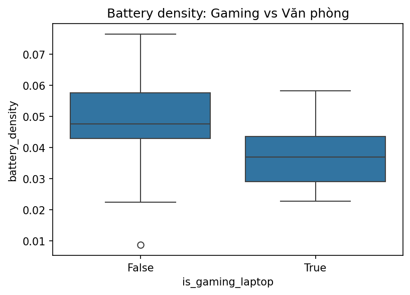
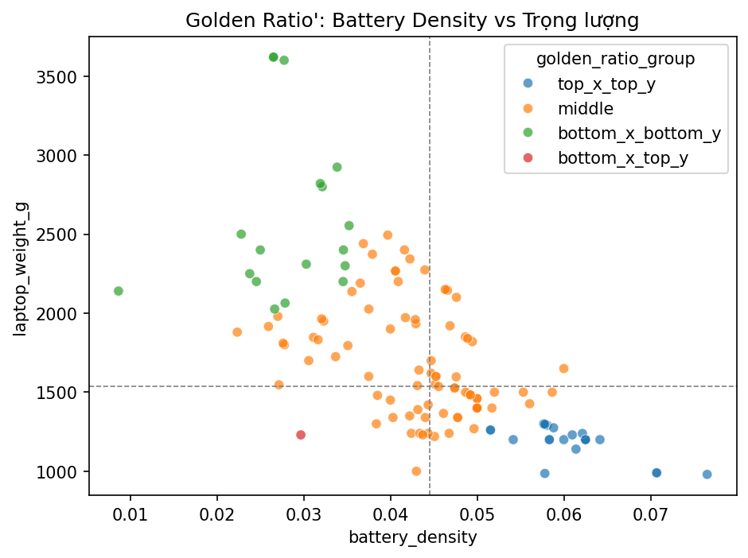
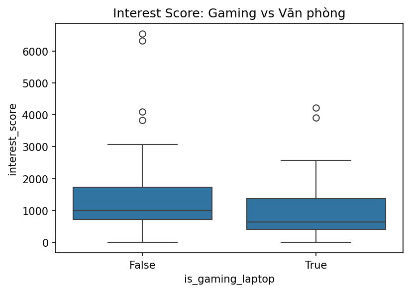
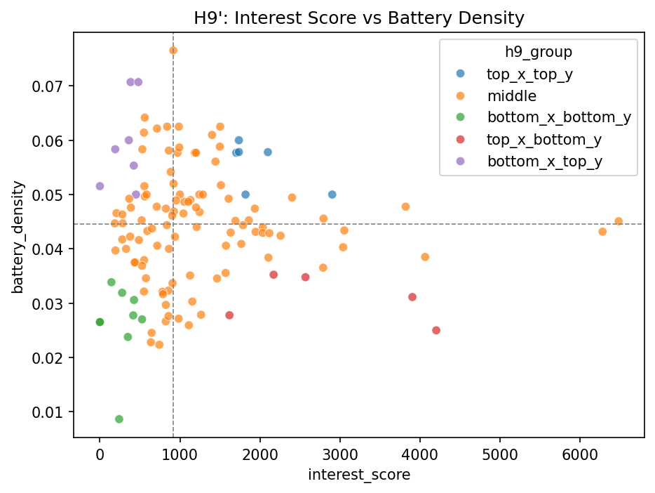

# Insight Summary — LapLap Tech Analytics

*Nguồn: dataset thực chiến LapLap Tech (ClickHouse). Toàn bộ phân tích dùng population đã làm
sạch (135/159 laptop, đã loại thiết bị không phải laptop và chuẩn hóa đơn vị). Chi tiết phương
pháp đầy đủ: xem docs/project_notes.md.*

## Về dữ liệu hành vi người dùng

Phân tích dùng `session_id`/`user_psuedo_id` chỉ để nhóm hành vi trong nội bộ xử lý dữ liệu.
Không có ID cá nhân nào được xuất ra trong báo cáo này — mọi số liệu dưới đây đều đã được
tổng hợp (aggregate) theo laptop_model_id.

---

## Insight 1 — Ultrabook mỏng nhẹ đang chiếm ưu thế về mật độ pin; gaming là ngoại lệ hiếm

**Pattern:** Laptop gaming có mật độ pin (dung lượng Whr / trọng lượng) thấp hơn rõ rệt so với
laptop văn phòng (kiểm định Mann-Whitney, p ≈ 10⁻⁷, effect size lớn r = 0.566). Trong 135 laptop,
có **24 model** đạt "Golden Ratio" — vừa nằm trong nhóm nhẹ nhất vừa có mật độ pin cao nhất.
Gần như toàn bộ là ultrabook văn phòng (Zenbook, Vivobook S, Swift, ThinkPad X1 Carbon, LG gram...);
ngoại lệ duy nhất là **Asus ROG Flow Z13** — laptop gaming dạng tablet 2-in-1.

**Quyết định kinh doanh đề xuất:**
- *Sản phẩm:* thêm bộ lọc/badge "Mật độ pin cao" trên app dựa trên chỉ số đã tính, giúp người
  dùng so sánh nhanh mà không cần tự nhẩm tính Whr/gram.
- *Nội dung:* sản xuất bài/video "TOP ultrabook pin khỏe nhất theo trọng lượng" dùng danh sách
  24 model làm nguồn, nhấn mạnh câu chuyện ROG Flow Z13 — gaming hiếm hoi lọt top nhẹ nhất.

**Ước tính tác động (giả định minh họa):** nếu badge "Mật độ pin cao" giúp tăng 5% CTR vào
trang chi tiết cho 24 model này (giả định: baseline CTR trang DeviceDetail là 8%, uplift 5%
tương đối → CTR mới ≈ 8.4%), và mỗi 1% CTR tăng thêm tương ứng ước tính 0.3% tăng traffic vào
link affiliate (giả định chuyển đổi giữ nguyên), tác động là traffic affiliate tăng nhẹ tập
trung vào nhóm 24 model — cần đo thực tế sau khi triển khai để xác nhận giả định.

**Giới hạn/Rủi ro:**
- Mật độ pin đo dung lượng *danh định* (Whr/trọng lượng), KHÔNG phải hiệu năng pin thực tế khi
  sử dụng — do `office_battery_result_minutes` chỉ có 1/135 dòng dữ liệu, không đủ để tính chỉ
  số hiệu năng thực tế (đã pivot công thức, xem chi tiết trong project_notes.md).
- Kết luận là mối liên hệ mô tả (descriptive), không phải quan hệ nhân quả.

---

## Insight 2 — Người dùng thực ra quan tâm laptop văn phòng NHIỀU HƠN laptop gaming

**Pattern:** Trái với giả thuyết ban đầu ("gaming được quan tâm/so sánh nhiều hơn"), dữ liệu
cho thấy **điều ngược lại**: mức độ quan tâm (đo bằng lượt xem chi tiết + lượt chọn so sánh)
của laptop văn phòng cao hơn gaming (trung vị 977.5 so với 638.0), khác biệt có ý nghĩa thống
kê (p = 0.024). Đã kiểm tra và loại trừ khả năng do laptop mới ra mắt được xem nhiều hơn (năm
ra mắt trung bình giữa 2 nhóm gần như không lệch: 2024.6 vs 2024.5).

**Quyết định kinh doanh đề xuất:**
- *Product/UX:* rà lại tỷ trọng hiển thị laptop gaming vs văn phòng trên trang chủ/gợi ý — nếu
  hiện đang ưu tiên gaming nhiều hơn nhu cầu thực tế, đây là cơ hội tối ưu bố cục.
- *Affiliate:* cân nhắc đẩy mạnh đề xuất mua hàng nhóm văn phòng thay vì mặc định tập trung
  vào gaming — đúng với nhu cầu người dùng đang thể hiện qua hành vi thực tế.

**Ước tính tác động (giả định minh họa):** nếu điều chỉnh tỷ trọng hiển thị theo đúng tỷ lệ
quan tâm thực tế (ước tính dịch chuyển 10% vị trí ưu tiên từ gaming sang văn phòng), và giả
định CTR nhóm văn phòng giữ nguyên khi được hiển thị nhiều hơn, có thể kỳ vọng tăng nhẹ tổng
lượt click vào trang chi tiết — cần A/B test thực tế để xác nhận, đây chỉ là ước tính định hướng.

**Giới hạn/Rủi ro:**
- Effect size ở mức trung bình (r = 0.236), không phải khác biệt cực lớn — không nên diễn giải
  quá mức thành "người dùng hoàn toàn không quan tâm gaming".
- `interest_score'` là chỉ số ước lượng (containment với dữ liệu đối chiếu ~78%), không phải
  phép đo tuyệt đối chính xác.
- Correlation không suy ra nhân quả — có thể còn biến nhiễu khác chưa kiểm soát (giá bán, vị
  trí hiển thị hiện tại trên trang chủ) ảnh hưởng đến lượt xem.

---

## Insight 3 — 2 model gaming: được quan tâm nhiều nhưng mật độ pin kém bất thường

**Pattern:** Trong nhóm laptop vừa được quan tâm nhiều (top 25% interest_score) vừa có mật độ
pin kém (bottom 25%), ban đầu tìm được 5 model — nhưng sau khi kiểm tra sâu, chỉ **2 model là
tín hiệu thật sự đáng chú ý**: mật độ pin của chúng thấp bất thường **ngay cả khi so sánh
trong nội bộ phân khúc gaming** (không phải do gaming nói chung vốn đã thấp hơn văn phòng như
ở Insight 1):

- **Lenovo LOQ 15ARP9 83JC0000US**
- **ASUS Gaming VivoBook K3605ZF-RP634W**

3 model còn lại trong nhóm 5 ban đầu chỉ phản ánh lại xu hướng chung đã nêu ở Insight 1, không
phải phát hiện độc lập.

**Quyết định kinh doanh đề xuất:**
- *Nội dung/Review:* sản xuất bài/video dạng cảnh báo hoặc so sánh sâu riêng cho 2 model này
  (ví dụ "Vì sao [model] hot nhưng pin lại là điểm trừ?") — nội dung dạng phản biện thường thu
  hút tương tác cao.
- *Affiliate:* cân nhắc thêm ghi chú/disclaimer về mật độ pin khi hiển thị 2 model này ở vị trí
  đề xuất mua hàng, tăng tính minh bạch và độ tin cậy của app.

**Ước tính tác động (giả định minh họa):** nội dung dạng "cảnh báo/phản biện" thường có CTR
cao hơn nội dung mô tả thông thường (giả định uplift 15-20% dựa trên xu hướng ngành content),
áp dụng cho 2 bài viết về 2 model này có thể mang lại lượt xem cao hơn trung bình bài review
thông thường — cần đo thực tế sau khi xuất bản.

**Giới hạn/Rủi ro:**
- Mẫu rất nhỏ (2 model) — đây là phát hiện mang tính minh họa cụ thể, không đại diện cho toàn
  bộ phân khúc gaming.
- Sensitivity check với các ngưỡng percentile khác nhau (20/25/30%) cho kết quả tăng dần đều
  (2 → 5 → 9 model), không có dấu hiệu bất thường do chọn đúng ngưỡng đẹp — nhưng vẫn cần xem
  đây là tín hiệu ban đầu, phù hợp làm chủ đề nội dung hơn là căn cứ ra quyết định lớn.
- Mật độ pin (danh định) không đồng nghĩa trải nghiệm pin thực tế kém — cần kiểm chứng thêm
  qua review thực tế trước khi đưa ra tuyên bố mạnh trong nội dung công khai.

---

## Tổng kết

| Insight | Đội ngũ chính | Đội ngũ liên quan | Loại hành động |
|---|---|---|---|
| 1. Golden Ratio ultrabook | Nội dung/Review | Sản phẩm/UX | Tính năng lọc + content |
| 2. Văn phòng > Gaming interest | Sản phẩm/UX | Kinh doanh/Affiliate | Tối ưu hiển thị |
| 3. 2 model "hot nhưng pin kém" | Nội dung/Review | Kinh doanh/Affiliate | Content cảnh báo |

*Toàn bộ số liệu, phương pháp kiểm định, và lịch sử các quyết định điều chỉnh (bao gồm các lần
pivot công thức do dữ liệu benchmark thưa) được ghi chi tiết tại `docs/project_notes.md`.*

